# Workspace Crate Dependency Graph

<!-- Generated by scripts/generate_dependency_chart.py; do not edit by hand. -->

This Mermaid chart is generated from `cargo metadata --no-deps` and
includes every workspace crate as a node. Only internal workspace
dependency edges are shown, so third-party crates are intentionally
omitted.

Regenerate it after changing workspace crates or internal dependencies:

```bash
python3 scripts/generate_dependency_chart.py
```

Check that the committed chart is current:

```bash
python3 scripts/generate_dependency_chart.py --check
```

Mermaid is rendered by standard Markdown viewers that support it, including GitHub.

Legend:

- `-->`: required normal dependency
- `-. optional .->`: optional normal dependency
- `==>`: build dependency
- `-. dev .->`: dev-only dependency

```mermaid
flowchart LR
  classDef root fill:#f7f7f7,stroke:#666,stroke-width:2px
  classDef crate fill:#fff,stroke:#777,stroke-width:1px
  subgraph group_root["Root"]
    direction TB
    crate_moenarch_video_analysis["moenarch-video-analysis"]:::root
  end

  subgraph group_image["Image"]
    direction TB
    crate_moenarch_image_analysis_comfyui["moenarch-image-analysis-comfyui"]:::crate
    crate_moenarch_image_analysis_comfyui_cli["moenarch-image-analysis-comfyui-cli"]:::crate
    crate_moenarch_image_analysis_comfyui_server["moenarch-image-analysis-comfyui-server"]:::crate
  end

  subgraph group_three_d["Three-D"]
    direction TB
    crate_moenarch_three_d_processing_core["moenarch-three-d-processing-core"]:::crate
    crate_moenarch_three_d_processing_core_cli["moenarch-three-d-processing-core-cli"]:::crate
    crate_moenarch_three_d_processing_core_server["moenarch-three-d-processing-core-server"]:::crate
    crate_moenarch_three_d_processing_io["moenarch-three-d-processing-io"]:::crate
    crate_moenarch_three_d_processing_io_cli["moenarch-three-d-processing-io-cli"]:::crate
    crate_moenarch_three_d_processing_io_server["moenarch-three-d-processing-io-server"]:::crate
    crate_moenarch_three_d_processing_mesh["moenarch-three-d-processing-mesh"]:::crate
    crate_moenarch_three_d_processing_mesh_cli["moenarch-three-d-processing-mesh-cli"]:::crate
    crate_moenarch_three_d_processing_mesh_server["moenarch-three-d-processing-mesh-server"]:::crate
    crate_moenarch_three_d_scene_svg["moenarch-three-d-scene-svg"]:::crate
    crate_moenarch_three_d_scene_svg_cli["moenarch-three-d-scene-svg-cli"]:::crate
    crate_moenarch_three_d_scene_svg_server["moenarch-three-d-scene-svg-server"]:::crate
  end

  subgraph group_video["Video"]
    direction TB
    crate_moenarch_video_analysis_cli["moenarch-video-analysis-cli"]:::crate
    crate_moenarch_video_analysis_gaussian_splatting["moenarch-video-analysis-gaussian-splatting"]:::crate
    crate_moenarch_video_analysis_gaussian_splatting_cli["moenarch-video-analysis-gaussian-splatting-cli"]:::crate
    crate_moenarch_video_analysis_gaussian_splatting_server["moenarch-video-analysis-gaussian-splatting-server"]:::crate
    crate_moenarch_video_analysis_mvs["moenarch-video-analysis-mvs"]:::crate
    crate_moenarch_video_analysis_mvs_cli["moenarch-video-analysis-mvs-cli"]:::crate
    crate_moenarch_video_analysis_mvs_server["moenarch-video-analysis-mvs-server"]:::crate
    crate_moenarch_video_analysis_radiance_fields["moenarch-video-analysis-radiance-fields"]:::crate
    crate_moenarch_video_analysis_radiance_fields_cli["moenarch-video-analysis-radiance-fields-cli"]:::crate
    crate_moenarch_video_analysis_radiance_fields_server["moenarch-video-analysis-radiance-fields-server"]:::crate
    crate_moenarch_video_analysis_radiance_io["moenarch-video-analysis-radiance-io"]:::crate
    crate_moenarch_video_analysis_radiance_io_cli["moenarch-video-analysis-radiance-io-cli"]:::crate
    crate_moenarch_video_analysis_radiance_io_server["moenarch-video-analysis-radiance-io-server"]:::crate
    crate_moenarch_video_analysis_radiance_pipeline["moenarch-video-analysis-radiance-pipeline"]:::crate
    crate_moenarch_video_analysis_radiance_pipeline_cli["moenarch-video-analysis-radiance-pipeline-cli"]:::crate
    crate_moenarch_video_analysis_radiance_pipeline_server["moenarch-video-analysis-radiance-pipeline-server"]:::crate
    crate_moenarch_video_analysis_reconstruction["moenarch-video-analysis-reconstruction"]:::crate
    crate_moenarch_video_analysis_reconstruction_cli["moenarch-video-analysis-reconstruction-cli"]:::crate
    crate_moenarch_video_analysis_reconstruction_server["moenarch-video-analysis-reconstruction-server"]:::crate
    crate_moenarch_video_analysis_sfm["moenarch-video-analysis-sfm"]:::crate
    crate_moenarch_video_analysis_sfm_cli["moenarch-video-analysis-sfm-cli"]:::crate
    crate_moenarch_video_analysis_sfm_server["moenarch-video-analysis-sfm-server"]:::crate
  end

  subgraph group_comfyui["ComfyUI"]
    direction TB
    crate_moenarch_comfyui_data["moenarch-comfyui-data"]:::crate
    crate_moenarch_comfyui_data_cli["moenarch-comfyui-data-cli"]:::crate
    crate_moenarch_comfyui_data_server["moenarch-comfyui-data-server"]:::crate
    crate_moenarch_comfyui_latents["moenarch-comfyui-latents"]:::crate
    crate_moenarch_comfyui_latents_cli["moenarch-comfyui-latents-cli"]:::crate
    crate_moenarch_comfyui_latents_server["moenarch-comfyui-latents-server"]:::crate
    crate_moenarch_comfyui_models["moenarch-comfyui-models"]:::crate
    crate_moenarch_comfyui_models_cli["moenarch-comfyui-models-cli"]:::crate
    crate_moenarch_comfyui_models_server["moenarch-comfyui-models-server"]:::crate
  end

  subgraph group_bindings["Bindings"]
    direction TB
    crate_moenarch_animation_core_wasm["moenarch-animation-core-wasm"]:::crate
    crate_moenarch_comfyui_data_wasm["moenarch-comfyui-data-wasm"]:::crate
    crate_moenarch_comfyui_latents_wasm["moenarch-comfyui-latents-wasm"]:::crate
    crate_moenarch_comfyui_models_wasm["moenarch-comfyui-models-wasm"]:::crate
    crate_moenarch_image_analysis_comfyui_wasm["moenarch-image-analysis-comfyui-wasm"]:::crate
    crate_moenarch_three_d_processing_core_wasm["moenarch-three-d-processing-core-wasm"]:::crate
    crate_moenarch_three_d_processing_io_wasm["moenarch-three-d-processing-io-wasm"]:::crate
    crate_moenarch_three_d_processing_mesh_wasm["moenarch-three-d-processing-mesh-wasm"]:::crate
    crate_moenarch_three_d_scene_svg_wasm["moenarch-three-d-scene-svg-wasm"]:::crate
    crate_moenarch_video_analysis_gaussian_splatting_wasm["moenarch-video-analysis-gaussian-splatting-wasm"]:::crate
    crate_moenarch_video_analysis_mvs_wasm["moenarch-video-analysis-mvs-wasm"]:::crate
    crate_moenarch_video_analysis_radiance_fields_wasm["moenarch-video-analysis-radiance-fields-wasm"]:::crate
    crate_moenarch_video_analysis_radiance_io_wasm["moenarch-video-analysis-radiance-io-wasm"]:::crate
    crate_moenarch_video_analysis_radiance_pipeline_wasm["moenarch-video-analysis-radiance-pipeline-wasm"]:::crate
    crate_moenarch_video_analysis_reconstruction_wasm["moenarch-video-analysis-reconstruction-wasm"]:::crate
    crate_moenarch_video_analysis_sfm_wasm["moenarch-video-analysis-sfm-wasm"]:::crate
  end

  subgraph group_test_support["Test Support"]
    direction TB
    crate_moenarch_video_analysis_test_support["moenarch-video-analysis-test-support"]:::crate
  end

  subgraph group_prototypes["Prototypes"]
    direction TB
    crate_moenarch_video_analysis_use_cases["moenarch-video-analysis-use-cases"]:::crate
  end

  subgraph group_animation["Animation"]
    direction TB
    crate_moenarch_animation_core["moenarch-animation-core"]:::crate
    crate_moenarch_animation_core_cli["moenarch-animation-core-cli"]:::crate
    crate_moenarch_animation_core_server["moenarch-animation-core-server"]:::crate
  end

  crate_moenarch_video_analysis -. optional .-> crate_moenarch_image_analysis_comfyui
  crate_moenarch_video_analysis -. optional .-> crate_moenarch_three_d_processing_core
  crate_moenarch_video_analysis -. optional .-> crate_moenarch_three_d_processing_io
  crate_moenarch_video_analysis -. optional .-> crate_moenarch_three_d_processing_mesh
  crate_moenarch_video_analysis -. optional .-> crate_moenarch_three_d_scene_svg
  crate_moenarch_video_analysis -. optional .-> crate_moenarch_video_analysis_gaussian_splatting
  crate_moenarch_video_analysis -. optional .-> crate_moenarch_video_analysis_mvs
  crate_moenarch_video_analysis -. optional .-> crate_moenarch_video_analysis_radiance_fields
  crate_moenarch_video_analysis -. optional .-> crate_moenarch_video_analysis_radiance_io
  crate_moenarch_video_analysis -. optional .-> crate_moenarch_video_analysis_radiance_pipeline
  crate_moenarch_video_analysis -. optional .-> crate_moenarch_video_analysis_reconstruction
  crate_moenarch_video_analysis -. optional .-> crate_moenarch_video_analysis_sfm
  crate_moenarch_video_analysis -. optional .-> crate_moenarch_comfyui_data
  crate_moenarch_video_analysis -. optional .-> crate_moenarch_comfyui_latents
  crate_moenarch_video_analysis -. optional .-> crate_moenarch_comfyui_models
  crate_moenarch_video_analysis -. dev .-> crate_moenarch_video_analysis_test_support
  crate_moenarch_video_analysis -. optional .-> crate_moenarch_animation_core
  crate_moenarch_image_analysis_comfyui --> crate_moenarch_comfyui_data
  crate_moenarch_image_analysis_comfyui --> crate_moenarch_comfyui_models
  crate_moenarch_image_analysis_comfyui_cli --> crate_moenarch_image_analysis_comfyui
  crate_moenarch_image_analysis_comfyui_server --> crate_moenarch_image_analysis_comfyui
  crate_moenarch_three_d_processing_core_cli --> crate_moenarch_three_d_processing_core
  crate_moenarch_three_d_processing_core_server --> crate_moenarch_three_d_processing_core
  crate_moenarch_three_d_processing_io --> crate_moenarch_three_d_processing_core
  crate_moenarch_three_d_processing_io --> crate_moenarch_three_d_processing_mesh
  crate_moenarch_three_d_processing_io_cli --> crate_moenarch_three_d_processing_io
  crate_moenarch_three_d_processing_io_server --> crate_moenarch_three_d_processing_io
  crate_moenarch_three_d_processing_mesh --> crate_moenarch_three_d_processing_core
  crate_moenarch_three_d_processing_mesh_cli --> crate_moenarch_three_d_processing_mesh
  crate_moenarch_three_d_processing_mesh_server --> crate_moenarch_three_d_processing_mesh
  crate_moenarch_three_d_scene_svg --> crate_moenarch_three_d_processing_core
  crate_moenarch_three_d_scene_svg --> crate_moenarch_three_d_processing_mesh
  crate_moenarch_three_d_scene_svg_cli --> crate_moenarch_three_d_scene_svg
  crate_moenarch_three_d_scene_svg_server --> crate_moenarch_three_d_scene_svg
  crate_moenarch_video_analysis_cli --> crate_moenarch_three_d_processing_io
  crate_moenarch_video_analysis_gaussian_splatting --> crate_moenarch_three_d_processing_core
  crate_moenarch_video_analysis_gaussian_splatting --> crate_moenarch_video_analysis_radiance_fields
  crate_moenarch_video_analysis_gaussian_splatting_cli --> crate_moenarch_video_analysis_gaussian_splatting
  crate_moenarch_video_analysis_gaussian_splatting_server --> crate_moenarch_video_analysis_gaussian_splatting
  crate_moenarch_video_analysis_mvs --> crate_moenarch_three_d_processing_core
  crate_moenarch_video_analysis_mvs --> crate_moenarch_three_d_processing_mesh
  crate_moenarch_video_analysis_mvs --> crate_moenarch_video_analysis_radiance_fields
  crate_moenarch_video_analysis_mvs -. dev .-> crate_moenarch_video_analysis_radiance_io
  crate_moenarch_video_analysis_mvs --> crate_moenarch_video_analysis_reconstruction
  crate_moenarch_video_analysis_mvs_cli --> crate_moenarch_video_analysis_mvs
  crate_moenarch_video_analysis_mvs_server --> crate_moenarch_video_analysis_mvs
  crate_moenarch_video_analysis_radiance_fields --> crate_moenarch_three_d_processing_core
  crate_moenarch_video_analysis_radiance_fields_cli --> crate_moenarch_video_analysis_radiance_fields
  crate_moenarch_video_analysis_radiance_fields_server --> crate_moenarch_video_analysis_radiance_fields
  crate_moenarch_video_analysis_radiance_io --> crate_moenarch_video_analysis_gaussian_splatting
  crate_moenarch_video_analysis_radiance_io --> crate_moenarch_video_analysis_radiance_fields
  crate_moenarch_video_analysis_radiance_io --> crate_moenarch_video_analysis_reconstruction
  crate_moenarch_video_analysis_radiance_io_cli --> crate_moenarch_video_analysis_radiance_io
  crate_moenarch_video_analysis_radiance_io_server --> crate_moenarch_video_analysis_radiance_io
  crate_moenarch_video_analysis_radiance_pipeline --> crate_moenarch_video_analysis_gaussian_splatting
  crate_moenarch_video_analysis_radiance_pipeline --> crate_moenarch_video_analysis_radiance_fields
  crate_moenarch_video_analysis_radiance_pipeline --> crate_moenarch_video_analysis_radiance_io
  crate_moenarch_video_analysis_radiance_pipeline --> crate_moenarch_video_analysis_reconstruction
  crate_moenarch_video_analysis_radiance_pipeline_cli --> crate_moenarch_video_analysis_radiance_pipeline
  crate_moenarch_video_analysis_radiance_pipeline_server --> crate_moenarch_video_analysis_radiance_pipeline
  crate_moenarch_video_analysis_reconstruction --> crate_moenarch_video_analysis_radiance_fields
  crate_moenarch_video_analysis_reconstruction_cli --> crate_moenarch_video_analysis_reconstruction
  crate_moenarch_video_analysis_reconstruction_server --> crate_moenarch_video_analysis_reconstruction
  crate_moenarch_video_analysis_sfm --> crate_moenarch_video_analysis_radiance_fields
  crate_moenarch_video_analysis_sfm --> crate_moenarch_video_analysis_radiance_io
  crate_moenarch_video_analysis_sfm --> crate_moenarch_video_analysis_reconstruction
  crate_moenarch_video_analysis_sfm_cli --> crate_moenarch_video_analysis_sfm
  crate_moenarch_video_analysis_sfm_server --> crate_moenarch_video_analysis_sfm
  crate_moenarch_comfyui_data_cli --> crate_moenarch_comfyui_data
  crate_moenarch_comfyui_data_server --> crate_moenarch_comfyui_data
  crate_moenarch_comfyui_latents_cli --> crate_moenarch_comfyui_latents
  crate_moenarch_comfyui_latents_server --> crate_moenarch_comfyui_latents
  crate_moenarch_comfyui_models_cli --> crate_moenarch_comfyui_models
  crate_moenarch_comfyui_models_server --> crate_moenarch_comfyui_models
  crate_moenarch_animation_core_wasm --> crate_moenarch_animation_core
  crate_moenarch_comfyui_data_wasm --> crate_moenarch_comfyui_data
  crate_moenarch_comfyui_latents_wasm --> crate_moenarch_comfyui_latents
  crate_moenarch_comfyui_models_wasm --> crate_moenarch_comfyui_models
  crate_moenarch_image_analysis_comfyui_wasm --> crate_moenarch_image_analysis_comfyui
  crate_moenarch_three_d_processing_core_wasm --> crate_moenarch_three_d_processing_core
  crate_moenarch_three_d_processing_io_wasm --> crate_moenarch_three_d_processing_io
  crate_moenarch_three_d_processing_mesh_wasm --> crate_moenarch_three_d_processing_mesh
  crate_moenarch_three_d_scene_svg_wasm --> crate_moenarch_three_d_scene_svg
  crate_moenarch_video_analysis_gaussian_splatting_wasm --> crate_moenarch_video_analysis_gaussian_splatting
  crate_moenarch_video_analysis_mvs_wasm --> crate_moenarch_video_analysis_mvs
  crate_moenarch_video_analysis_radiance_fields_wasm --> crate_moenarch_video_analysis_radiance_fields
  crate_moenarch_video_analysis_radiance_io_wasm --> crate_moenarch_video_analysis_radiance_io
  crate_moenarch_video_analysis_radiance_pipeline_wasm --> crate_moenarch_video_analysis_radiance_pipeline
  crate_moenarch_video_analysis_reconstruction_wasm --> crate_moenarch_video_analysis_reconstruction
  crate_moenarch_video_analysis_sfm_wasm --> crate_moenarch_video_analysis_sfm
  crate_moenarch_video_analysis_test_support --> crate_moenarch_video_analysis_radiance_fields
  crate_moenarch_video_analysis_test_support --> crate_moenarch_video_analysis_radiance_io
  crate_moenarch_video_analysis_use_cases --> crate_moenarch_image_analysis_comfyui
  crate_moenarch_video_analysis_use_cases --> crate_moenarch_comfyui_latents
  crate_moenarch_video_analysis_use_cases --> crate_moenarch_comfyui_models
  crate_moenarch_video_analysis_use_cases -. dev .-> crate_moenarch_video_analysis_test_support
  crate_moenarch_animation_core --> crate_moenarch_three_d_processing_core
  crate_moenarch_animation_core_cli --> crate_moenarch_animation_core
  crate_moenarch_animation_core_server --> crate_moenarch_animation_core
```


